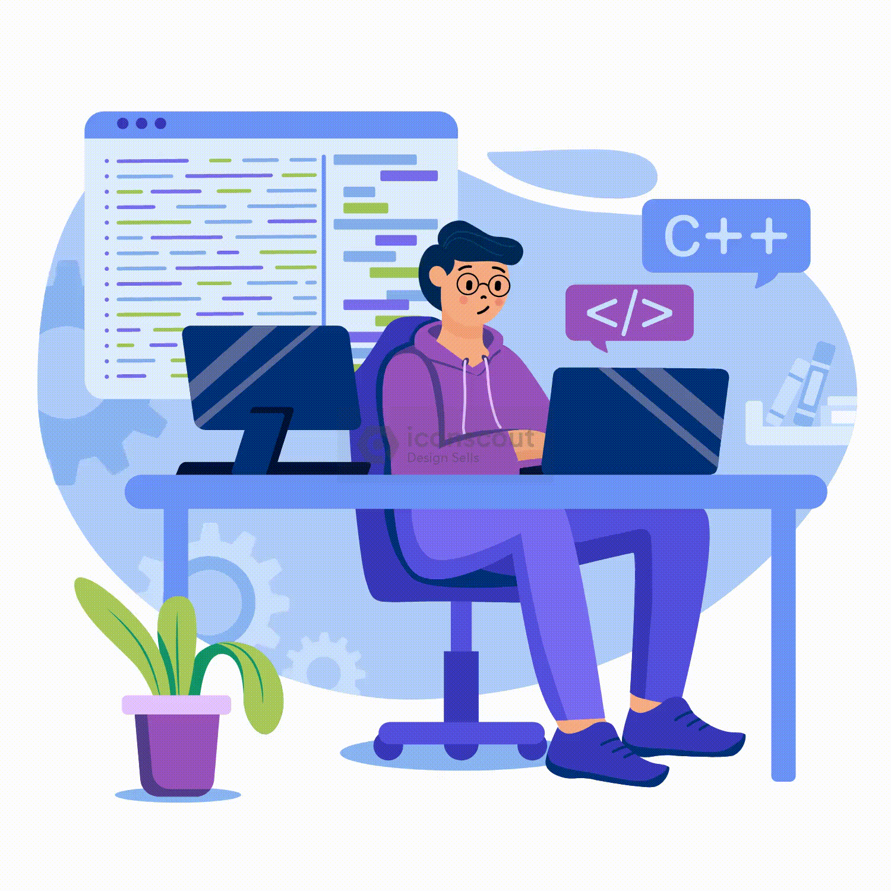

<h1 align="center">Hi 👋, I'm Zainab Mishaal</h1>
<h3 align="center">Full Stack Developer</h3>

  

-  **Welcome to my GitHub Profile ! Hi, I’m a full stack developer who enjoys building scalable web applications with clean architecture and intuitive UI/UX. I work mostly with React and Next.js on the frontend, and Node.js with MongoDB  on the backend. I’m passionate about reusable components, efficient APIs, and writing code that's easy to maintain and test.**

🛠️ Always exploring new tools, improving workflows, and contributing to better digital experiences.

- 📫 Let’s connect and build something great! **zainabmishaal2025@gmail.com**

<h3 align="left">Languages and Tools:</h3>

          

<h4><b>Skills</b></h4>
<ul>
  <li>Administrative &amp; Productivity: Google Workspace (Gmail, Google Drive, Google Docs, Google Sheets), Microsoft Office</li>
  <li>Project &amp; Task Management: Jira, Trello</li>
  <li>Communication &amp; Collaboration: Slack, Zoom, Microsoft Teams</li>
  <li>Front-End: HTML, CSS, JavaScript, React Native, React JS, Material UI, Bootstrap</li>
  <li>Back-End: Node.js, Express.js</li>
  <li>Database: MySQL, MongoDB</li>
  <li>Design Tools: Adobe XD, Figma</li>
</ul>

<h5>Projects</h5>
<ul>
  <li><Strong>Geo-fencing Marketing for Fast Food and Restaurants:</Strong> 
Couch Potato is an innovative mobile application designed to revolutionize the way restaurants interact with their customers. This project combines geofencing marketing, semantic analysis of customer comments, and web scraping techniques to provide restaurants with valuable insights and enhanced marketing capabilities.
</li>
  
</ul>

 I'm on the lookout for exciting job opportunities as a UX Designer. If you're searching for a passionate and creative team player.I'm eager to bring my expertise to your team. Collaboration and innovation are at the core of my work, and I love tackling challenges head-on.

Let's connect and explore the possibilities! Feel free to drop me a line at  <a href = "mailto: zainabmishaal2025@gmail.com">zainabmishaal2025@gmail.com</a> or connect with me on LinkedIn <a href="https://www.linkedin.com/in/zainab-mishaal/">Linked In</a> . I can't wait to embark on this journey together!

